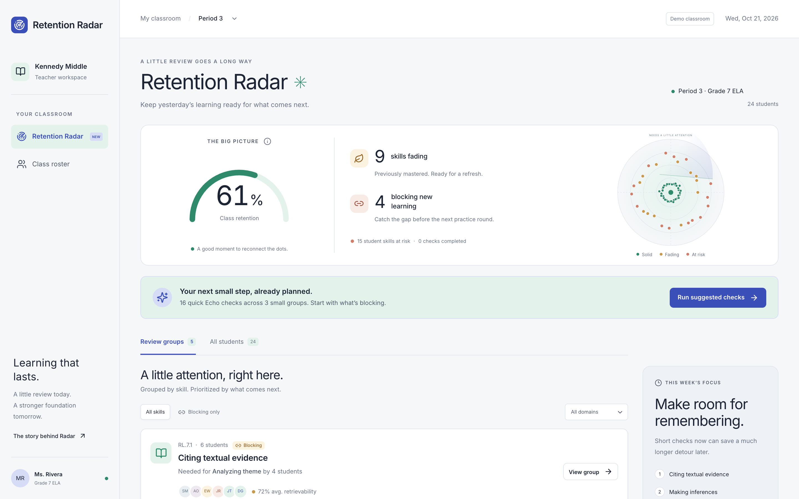

# Retention Radar

Keep yesterday’s learning ready for what comes next. A teacher-facing tool for spaced review of mastered skills in K-12 learning. It finds fading mastered skills, prioritizes prerequisites blocking current learning, and turns them into small-group Echo checks.



[Story hero](docs/story.png) · [Student view](docs/student.png) · [Mobile dashboard](docs/radar-mobile.png) · [Before → after diagram](docs/story-before-after.png)


## The problem

Adaptive K-12 learning platforms usually move a learner through three steps per skill: a short lesson, supported practice, and an independent mastery check (often a 90% gate). Once the check is passed, the skill is counted as mastered, and that count only ever goes up.

Memory does not work that way. A skill learned in September can be gone by November if nobody revisits it. Knowledge-tracing models estimate mastery from practice answers and have no notion of time, so a passed skill looks permanently known. In a prerequisite graph this hurts twice: a faded prerequisite makes the learner fail practice on the *dependent* skill, and the system reads that as "not ready" instead of "forgot the foundation".

Users and builders of popular tools in this space say the same thing: spacing out whole skills is much harder than spacing out flashcards, and a mastery gate shows that a learner arrived, not that the learning held.

## The feature, and why this one

- `/radar`: animated retention gauge and radar, fading / at-risk / blocking counts, ranked groups, domain and blocking filters, individual checks, searchable class roster, and a repeatable suggested-check demo.
- `/radar/student/:id`: a student’s skill states, mastery dates, next review dates, and review-history curves.
- **Echo check**: three authored multiple-choice questions. Two correct answers pass. No hints, tutor, AI scoring, or LLM calls. Results update the gauge and groups through a TanStack Query mutation and cache invalidation.
- `/story`: seven animated sections explaining the domain, retention gap, product choice, before → after workflow, modeled impact, and formula. Reduced-motion preferences render final states immediately.

Why this feature: the alternative, grouping learners by misconception, needs tutor-conversation telemetry that a standalone build would have to fake with an LLM. Retention Radar works from deterministic signals (mastery scores, review history, the prerequisite graph), keeps LLMs out of the mastery decision, and still produces small groups as its output.

## Run locally

Use Node.js 22. Installation needs network access; the running application uses **no external services, credentials, or environment variables**. Fonts and all assets are served locally.

```sh
npm install
npm run dev
```

Open `http://localhost:5173/radar` or `http://localhost:5173/story`.

```sh
npm test                 # Vitest unit, repository, and React component tests
npm run build            # Strict TypeScript check, then Vite production build
npx tsc --noEmit          # Standalone type check
npm run preview          # Serve the built app locally
npm run test:browser     # Build + Playwright against the production preview
```

Browser tests use installed Google Chrome on macOS. Elsewhere, install Playwright’s Chromium with `npx playwright install chromium`, or set the optional **test-only** `PLAYWRIGHT_CHROMIUM_EXECUTABLE_PATH`. No variable is needed by the app. Browser tests capture the screenshots in `docs/`.

`npm run format` formats source, tests, and configuration. `vercel.json` includes the SPA rewrite for direct route loads.

## Try the walkthrough

1. Open **Citing textual evidence**, the top group: six students, four needing it for **Analyzing theme**.
2. Run Destiny G.’s Echo. In this authored evidence set, the first choice is correct for all three questions. A 3/3 result restores retrievability to 100%, raises class retention from 61% to 63%, and moves her review to November 9 (about 19 days later).
3. Run Jonathan R.’s check with just one correct answer. His skill becomes **Relearn → back to practice**. The demo shows the handoff; guided practice itself is outside this feature.
4. **Run suggested checks** applies the remaining scripted outcomes from `src/seed/echoOutcomes.ts`. The class reaches **84%**. Already completed checks are not overwritten or applied twice.
5. **Reset demo classroom** restores the starting state. State is in memory and also resets on a full reload.

The fixed clock is **2026-10-21T15:00:00Z**. There are 24 synthetic students, 28 CCSS-tagged skills across six domains, 70 student–skill records, and 84 authored questions. Nine skill areas need review, four block current learning, and the suggested plan selects 16 checks across three groups. Additional groups and individual checks remain available.

Starting retention is `43 / 70 = 61.43%`. The script produces 15 passes and one lapse, so retained mastery becomes `58 / 69 = 84.06%`. Relearn states are excluded from the denominator as specified in the plan; they remain visible in **Back to practice**. This is **modeled retention on synthetic data**, not measured learning improvement.

## How the model works

The pure functions are in `src/lib/`:

```text
R(S, t) = (1 + t / (9 × S))⁻¹
initial S = clamp(4 + 60 × (MasteryScore − 0.90), 4, 10)

Echo pass (2 or 3 correct):
S′ = min(180, S × (1 + 1.6 × exp(−0.15 × reviews) × (1 − R) × 10 + 0.3))

Echo fail (0 or 1 correct):
S′ = max(1, S × 0.35), status = relearn

next review = last review + S × 9 × (1 / 0.85 − 1) days
priority = (1 − R) × (1 + 1.5 × blockingCount) × domainWeight
```

Scores below 90% cannot create mastered skills. Both Echo outcomes increment review count and append immutable history. A pass resets elapsed time and thus retrievability to 1. The next review targets 85%; retained mastery uses the plan’s separate 80% reporting threshold. Statuses are **solid ≥85%**, **fading 70–85%**, and **at risk <70%**, with relearn overriding them.

Blocking prerequisites are traced at most two edges from current lesson or practice work. Queue ties favor older review dates. Groups share a skill, sort learners by lowest retrievability, split at six, and rank by summed priority. Singleton skills become individual checks.

The power curve is FSRS-style; the Echo growth rule is an explicit heuristic, not a calibrated production FSRS scheduler. Seed review histories replay through the same pure update function used at runtime.

## Stack and data boundary

A common production stack for this kind of product:

- React **18.3**, Vite **5**, strict TypeScript **5**, React Router **6**.
- Tailwind CSS **3**, copied shadcn-style Button / Card / Dialog / Badge / Progress / Tooltip components, Radix primitives, CVA, clsx, tailwind-merge, and Lucide icons.
- TanStack Query **5** for every repository read and mutation.
- Motion (`motion/react`) for SVG, entrance, scroll, and metric animation.
- Local `@fontsource` Inter.
- Vitest, Testing Library, jsdom, and Playwright browser checks.

Every runtime data read/write goes through `RetentionRepository`. `MemoryRetentionRepository` owns isolated seed snapshots, applies Echo updates, and implements idempotent demo actions. The repository and clock are injectable for tests.

`src/data/supabaseRepo.ts` is a **typed integration stub, not wired into the application**. It illustrates the Supabase queries and deliberately throws until production mapping and transactional scoring are implemented. `supabase/migrations/0001_skill_retention.sql` documents skills, prerequisites, retention states, Echo reviews, progress, foreign keys, and default-deny RLS.

## Porting to a real platform

Replace the injected memory adapter with an authenticated Supabase implementation. Map existing student/class identifiers and snake_case rows into the repository types; load graph edges and review history; implement membership-based RLS; and score authored answers on the server in an idempotent transaction that locks the retention row before appending a review. The demo keeps answer keys in the browser because it has no server.

Compute `next_review_at` in a nightly job, and link relearn states into the platform's guided-practice flow. Suggested scripted outcomes and classroom reset are demo-only. Validate the scheduling heuristic against real retention outcomes before using its estimates for educational decisions.

## Verification

Verified locally: **76 Vitest tests passed**, **7 production-browser tests passed**, `npm run build` passed, and `npx tsc --noEmit` passed.

The suite covers curve boundaries, input validation, purity, growth and lapse rules, review dates, graph depth and cycles, blocking priority, tie-breaking, chunking, seed bands, replayable histories, repository isolation/idempotency, mutation-driven UI updates, assessment independence, student routes, and reduced motion.

Production browser checks exercise pass/fail results, the 61% → 84% plan, reset, roster navigation, mobile dialogs, filters, offline assets, animated and reduced-motion story states, and overflow at **320, 375, 390, 414, 768, and 1440 px**. Total production JavaScript is approximately **173 KB gzip**, below the plan’s 300 KB limit.

## Built with Codex, verified by Claude Code

Independent project built with **Codex** (OpenAI Codex CLI) and independently verified by **Claude Code** (clean install, tests, production build, live route checks and code review). All classroom data is synthetic. No real credentials or LLM calls are used.
